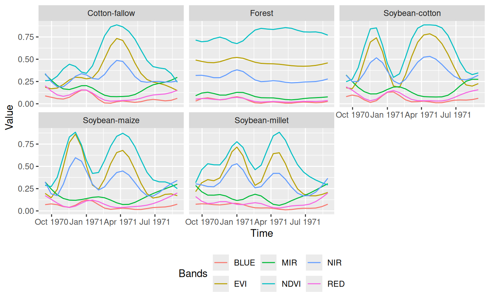
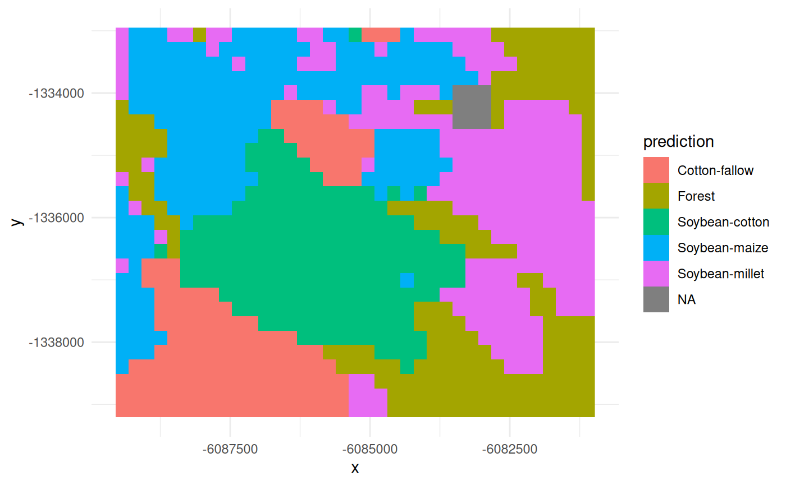

# 1. Land use mapping using TWDTW-KNN and stars

This vignette offers a concise guide for using the `dtwSat` package to
generate a land-use map. The package utilizes Time-Weighted Dynamic Time
Warping (TWDTW) along with a k-nearest neighbour (KNN) classifier, by
default with the nearest neighbour. The subsequent sections will walk
you through the process of creating a land-use map based on a set of
training samples and a multi-band satellite image time series.

## Reading Training Samples

First, let’s read a set of training samples that come with the `dtwSat`
package installation.

``` r

library(dtwSat)

samples <- st_read(system.file("mato_grosso_brazil/samples.gpkg", package = "dtwSat"), quiet = TRUE)
```

Each sample is a point with a land-use `label` and the `start_date` and
`end_date` of the period in which the label is valid. To train the
model, `dtwSat` uses for each sample only the satellite images acquired
within this period.

## Preparing the Satellite Image Time Series

The `dtwSat` package supports satellite images read into R using the
`stars` package. The installation comes with a set of MOD13Q1 images for
a region within the Brazilian Amazon. Note that timing is crucial for
the TWDTW distance metric. To create a consistent image time series, we
start by extracting the date of acquisition from the MODIS file names
(Didan 2015).

``` r

tif_files <- dir(system.file("mato_grosso_brazil", package = "dtwSat"), pattern = "\\.tif$", full.names = TRUE)

# use the file names only, the path to the files can contain digits too
tif_names <- basename(tif_files)

acquisition_date <- as.Date(regmatches(tif_names, regexpr("[0-9]{8}", tif_names)), format = "%Y%m%d")

print(acquisition_date)
##  [1] "2011-09-14" "2011-09-30" "2011-10-16" "2011-11-01" "2011-11-17"
##  [6] "2011-12-03" "2011-12-19" "2012-01-01" "2012-01-17" "2012-02-02"
## [11] "2012-02-18" "2012-03-05" "2012-03-21" "2012-04-06" "2012-04-22"
## [16] "2012-05-08" "2012-05-24" "2012-06-09" "2012-06-25" "2012-07-11"
## [21] "2012-07-27" "2012-08-12" "2012-08-28"
```

*Side note:* The date in the file name is not the true acquisition date
for each pixel. MOD13Q1 is a 16-day composite product, and the date in
the file name is the first day of this 16-day period.

With the files and dates in hand, we can construct a stars satellite
image time series for `dtwSat`.

``` r

# read data-cube
dc <- read_stars(tif_files,
                 along = list(time = acquisition_date),
                 RasterIO = list(bands = 1:6))

# set band names
dc <- st_set_dimensions(dc, 3, c("EVI", "NDVI", "RED", "BLUE", "NIR", "MIR"))

# convert band dimension to attribute
dc <- split(dc, c("band"))

print(dc)
## stars object with 3 dimensions and 6 attributes
## attribute(s):
##         Min. 1st Qu. Median       Mean 3rd Qu.   Max. NAs   NA's
## EVI   0.0636  0.2350 0.3883 0.40567166  0.5367 0.9994   0 0.0636
## NDVI  0.1462  0.3855 0.6099 0.58831591  0.7849 0.9819   0 0.1462
## RED   0.0015  0.0419 0.0692 0.08195341  0.1119 0.4007   0 0.0015
## BLUE  0.0012  0.0216 0.0365 0.04992652  0.0617 0.4174   9 0.0000
## NIR   0.0582  0.2465 0.3024 0.32209612  0.3813 0.7246   0 0.0582
## MIR   0.0276  0.0966 0.1411 0.15764017  0.2104 0.4161   0 0.0276
## dimension(s):
##      from to   offset  delta                       refsys point
## x       1 37 -6089551  231.7 +proj=sinu +lon_0=0 +x_0=... FALSE
## y       1 27 -1332951 -231.7 +proj=sinu +lon_0=0 +x_0=... FALSE
## time    1 23       NA     NA                         Date    NA
##                         values x/y
## x                         NULL [x]
## y                         NULL [y]
## time 2011-09-14,...,2012-08-28
```

Note that it’s important to set the date for each observation using the
parameter `along`. This will produce a 4D array (data-cube) that will be
collapsed into a 3D array by converting the ‘band’ dimension into
attributes. This prepares the data for training the TWDTW-KNN model.

## Creating the TWDTW-KNN Model

There are several ways to build the TWDTW-KNN model. The default option
is to keep all samples as part of the model. However, this implies a
higher computational time for prediction. To speed up the processing,
here I show how to reduce the samples to a single temporal pattern for
each land-use class using Generalized Additive Models (GAM). That can be
achieved by defining a smoothing function with the argument
`resampling_fun`, such as

``` r

library(mgcv)

twdtw_model <- twdtw_knn(x = dc,
                         y = samples,
                         resampling_fun = function(data) mgcv::gam(y ~ s(x), data = data),
                         cycle_length = 'year',
                         time_scale = 'day',
                         time_weight = c(steepness = 0.1, midpoint = 50))

print(twdtw_model)
## 
## Model of class 'twdtw_knn'
## ----------------------------
## Call:
## twdtw_knn(x = dc, y = samples, time_weight = c(steepness = 0.1, midpoint = 50), cycle_length = "year", 
##     time_scale = "day", resampling_fun = function(data) mgcv::gam(y ~ s(x), data = data))
## 
## Data:
##   5 temporal patterns, one for each label created with 'resampling_fun'
##   Bands: EVI, NDVI, RED, BLUE, NIR, MIR 
## 
##           label patterns observations       from         to
##   Cotton-fallow        1           23 1970-09-14 1971-08-29
##          Forest        1           23 1970-09-14 1971-08-29
##  Soybean-cotton        1           23 1970-09-14 1971-08-29
##   Soybean-maize        1           23 1970-09-14 1971-08-29
##  Soybean-millet        1           23 1970-09-14 1971-08-29
## 
## Root Mean Squared Error (RMSE) of smooth models:
##      Cotton-fallow     Forest Soybean-cotton Soybean-millet Soybean-maize
## EVI     0.07136100 0.07548927     0.09837789     0.08226513    0.07525433
## NDVI    0.06365170 0.07833016     0.08682990     0.09166950    0.07688487
## RED     0.02652048 0.01965245     0.02423174     0.02349431    0.02919917
## BLUE    0.03433816 0.02759463     0.02846576     0.02259862    0.03894198
## NIR     0.06386263 0.04957903     0.06525658     0.05132751    0.05900557
## MIR     0.03972322 0.03681205     0.03498298     0.04140825    0.03800280
## 
## TWDTW Arguments:
##  - time_weight: c(steepness=0.1, midpoint=50)
##  - cycle_length: year
##  - time_scale: day
##  - origin: NULL
##  - max_elapsed: Inf
```

In addition to the mandatory arguments `x` (satellite data-cube) and `y`
(training samples), the TWDTW distance calculation also requires setting
`cycle_length`, `time_scale`, and `time_weight`. For more details, refer
to the documentation using
[`?twdtw`](https://rdrr.io/pkg/twdtw/man/twdtw.html). The model will
resample the training set using the defined function, collapsing all
samples with the same land-use label into a single temporal pattern.
This reduces computational demands. The temporal patterns of the model
can be visualized as follows:

``` r

plot(twdtw_model)
```



## Land Use Prediction

Finally, we predict the land-use classes for each pixel location in the
data-cube:

``` r

lu_map <- predict(dc, model = twdtw_model)
print(lu_map)
## stars object with 2 dimensions and 2 attributes
## attribute(s):
##          prediction     distance     
##  Cotton-fallow :151   Min.   :1.867  
##  Forest        :196   1st Qu.:2.615  
##  Soybean-cotton:202   Median :3.076  
##  Soybean-maize :219   Mean   :3.253  
##  Soybean-millet:222   3rd Qu.:3.790  
##  NAs           :  9   Max.   :5.639  
##                       NAs    :9      
## dimension(s):
##   from to   offset  delta                       refsys point x/y
## x    1 37 -6089551  231.7 +proj=sinu +lon_0=0 +x_0=... FALSE [x]
## y    1 27 -1332951 -231.7 +proj=sinu +lon_0=0 +x_0=... FALSE [y]
```

The ‘time’ dimension was reduced to a single map with two attributes:
`prediction` is the land-use class of each pixel, and `distance` is the
TWDTW distance to the nearest temporal pattern. We can now visualize the
land-use classes using `ggplot`:

``` r

ggplot() +
  geom_stars(data = lu_map) +
  theme_minimal()
```



Note that some pixels (in a 3x3 box) in the northeast part of the map
have `NA` values. These pixels have a missing value in the blue band
recorded on 2011-11-17. The call above uses the `predict` method of the
stars package, which replaces the missing values with zeros before the
prediction and then sets the result of every pixel that had a missing
value to `NA`. Therefore, a single missing value is enough for a pixel
to have no land-use class.

TWDTW does not need complete time series. To classify the pixels with
missing values using their remaining observations, pass the data-cube to
the model:

``` r

lu_map <- predict(twdtw_model, newdata = dc)

ggplot() +
  geom_stars(data = lu_map) +
  theme_minimal()
```


In this call the observation of 2011-11-17 is not used for the nine
pixels, and all pixels have a land-use class.

The land-use classes can then be written to a TIFF file:

``` r

write_stars(lu_map["prediction"], "lu_map.tif")
```

## Further Reading

This introduction outlined the use of `dtwSat` for land-use mapping. For
more in-depth information, refer to the papers by Maus et al. (2016) and
Maus et al. (2019) and the [`twdtw` R package
documentation](https://CRAN.R-project.org/package=twdtw). The help page
[`?predict.twdtw_knn`](https://rdrr.io/pkg/twdtw/man/predict.twdtw_knn.html)
describes how to classify with more than one nearest neighbour. Images
that do not fit in memory can be classified as a stars proxy object,
which [`predict()`](https://rdrr.io/r/stats/predict.html) reads in
blocks of rows, see
[`?twdtw_knn_predict.stars`](http://r-spatial.github.io/dtwSat/reference/twdtw_knn_predict.stars.md).
The [second
vignette](http://r-spatial.github.io/dtwSat/articles/benchmark.md)
compares the accuracy and the processing time of TWDTW with random
forest and SVM.

For additional details on how to manage input and output satellite
images, check the [`stars`
documentation](https://CRAN.R-project.org/package=stars).

## References

Didan, Kamel. 2015. *MOD13Q1 MODIS/Terra Vegetation Indices 16-Day L3
Global 250m SIN Grid V006 \[Data set\], NASA EOSDIS LP DAAC*.

Maus, Victor, Gilberto Camara, Marius Appel, and Edzer Pebesma. 2019.
“dtwSat: Time-Weighted Dynamic Time Warping for Satellite Image Time
Series Analysis in R.” *Journal of Statistical Software* 88 (5): 1–31.
<https://doi.org/10.18637/jss.v088.i05>.

Maus, Victor, Gilberto Camara, Ricardo Cartaxo, Alber Sanchez, Fernando
M. Ramos, and Gilberto R. de Queiroz. 2016. “A Time-Weighted Dynamic
Time Warping Method for Land-Use and Land-Cover Mapping.” *IEEE Journal
of Selected Topics in Applied Earth Observations and Remote Sensing* 9
(8): 3729–39. <https://doi.org/10.1109/JSTARS.2016.2517118>.
